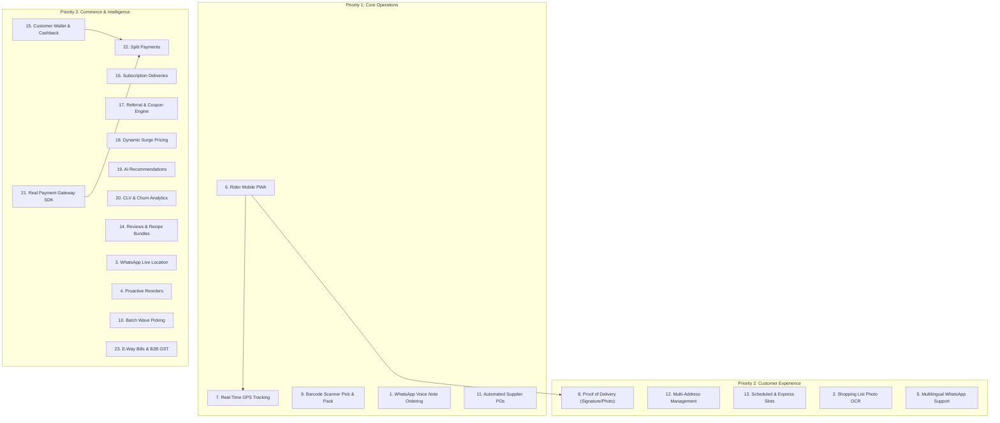

# FreshCart Add-On Features Implementation Plan & Execution Roadmap

> **Document Type:** Authoritative Master Plan & Living Tracker  
> **Repository:** [abhinav-badhe/InternsipProject](https://github.com/abhinav-badhe/InternsipProject.git)  
> **Version:** 1.0.0-draft  
> **Last Updated:** November 2026  

---

## 1. Project Overview

### 1.1 Objective
FreshCart is an omnichannel, hyperlocal grocery quick-commerce platform delivering groceries within 10–15 minutes through dark stores, micro-warehouses, a responsive web storefront, and native WhatsApp conversational commerce. 

The primary goal of this add-on roadmap is to scale the current working platform into an enterprise-ready, production-grade quick commerce ecosystem without replacing, breaking, or duplicating existing architecture.

### 1.2 Existing Architecture Baseline
The existing system is organized as a high-performance TypeScript monorepo powered by `pnpm`:
* **API Gateway (`services/api-gateway`, Port 3000):** Central reverse proxy, JWT authentication verification, tenancy isolation, correlation ID propagation.
* **11 Domain Microservices (Ports 3001–3011):**
  * `catalog-service` (3001): Products, categories, brands, variants, multi-level disambiguation.
  * `pricing-service` (3002): Real-time pricing quotes, tiered GST (CGST/SGST) tax ledger.
  * `inventory-service` (3003): Stock balances, two-phase reservation holds, compensating rollback.
  * `order-service` (3004): Checkout saga orchestrator, ACID order persistence, status transitions.
  * `whatsapp-adapter` (3005): Meta WhatsApp Cloud API connector, NLP shopping list parsing, interactive button dispatch.
  * `payment-service` (3006): Payment intent creation, UPI deep-links, settlement reconciliation.
  * `identity-service` (3007): Customer mobile OTP auth, Shopkeeper 2FA credentials, JWT token manager.
  * `fulfillment-service` (3008): Warehouse pick lists, pick items, packing slips, zone assignments.
  * `invoice-service` (3009): B2C GST invoices, sequential invoice numbers, PDF receipts.
  * `analytics-service` (3010): AutoML tournament engine (Ridge Autoregressive ML), stockout risk alerts, demand forecasting.
  * `notification-service` (3011): Multi-channel dispatcher, user notification preferences.
* **Web Applications (`apps/`):**
  * `customer-web` (Port 5173): React + Vite + Tailwind CSS storefront with customer mobile OTP login, live catalog search, stock reservation, order tracking, and UPI/COD payment modal.
  * `store-admin-web` (Port 5174): React + Vite + Tailwind CSS seller hub for merchant stock management, ML demand alerts, GST billing, and WhatsApp chat simulator.
* **Database & Persistence:**
  * PostgreSQL (Supabase Connection Pooler / Local Postgres) with relational tables across all 11 business domains.
  * Transactional Outbox Pattern (`outbox_events` table) with background worker (`workers/event-workers`).

---

## 2. Existing Feature Audit

| Feature / Module | Existing Status | Relevant Files & Services | What Can Be Reused | What Additional Work Is Required |
| :--- | :--- | :--- | :--- | :--- |
| **Catalog & Search** | ALREADY IMPLEMENTED | `services/catalog-service/`, `apps/customer-web/` | 1,417 products, categories, brands, search disambiguation | Add AI recommendation carousels |
| **Two-Phase Inventory Hold** | ALREADY IMPLEMENTED | `services/inventory-service/`, `checkout.saga.ts` | Atomic reservations, rollback compensation on timeout | Add barcode scanning during pick/pack |
| **Customer Mobile OTP Login** | ALREADY IMPLEMENTED | `services/identity-service/`, `apps/customer-web/AuthModal.tsx` | Phone-based auth, optional email, WhatsApp OTP delivery | Add customer profile & address book |
| **Shopkeeper 2FA Login** | ALREADY IMPLEMENTED | `services/identity-service/`, `apps/store-admin-web/AdminAuthModal.tsx` | `STORE_ADMIN` provisioning, 2FA challenge tokens | Add role-based rider authorization |
| **Checkout Saga & Orders** | ALREADY IMPLEMENTED | `services/order-service/`, `checkout.saga.ts` | Idempotent checkout, pick-list generation, outbox events | Add rider assignment, delivery slots |
| **WhatsApp Conversational Bot** | ALREADY IMPLEMENTED | `services/whatsapp-adapter/`, `meta.client.ts`, `whatsapp.bot.ts` | Meta Graph API client, multi-item shopping list NLP, interactive buttons | Add voice audio transcription, OCR list |
| **WhatsApp Payment Delivery** | ALREADY IMPLEMENTED | `services/order-service/`, `services/whatsapp-adapter/` | Automated payment dispatch, UPI deep links, COD support | Add real webhook SDK (Razorpay/Stripe) |
| **AutoML Demand Forecaster** | ALREADY IMPLEMENTED | `services/analytics-service/src/ml-engine.ts`, `forecaster.service.ts` | Ridge Autoregressive ML engine, 7,770 historical data points, alerts table | Connect alerts to auto-generate Supplier Purchase Orders |
| **Warehouse Pick Lists** | PARTIALLY IMPLEMENTED | `services/fulfillment-service/`, `orders` table | Tables `pick_lists`, `pick_items` auto-generated on checkout | UI scanner, batch wave picking, barcode verification |
| **Rider Delivery Tracking** | NOT IMPLEMENTED | None (Order status stops at `DISPATCHED` / `DELIVERED`) | Status enums in `orders` table | Rider PWA, GPS tracking map, proof of delivery |
| **Multi-Address Management**| PARTIALLY IMPLEMENTED | `delivery_address` JSONB in `orders` | Single address capture in checkout payload | Dedicated `customer_addresses` table, address selector UI |
| **Customer Wallet & Credits**| NOT IMPLEMENTED | None | `payment-service` architecture | `wallets`, `wallet_transactions` tables, split-pay logic |

---

## 3. Add-On Features Roadmap (23 Features)

### Group A: WhatsApp and Conversational AI

#### Feature 1: Voice Note / Audio Ordering using Speech-to-Text
* **Description:** Customers can send an audio voice note on WhatsApp describing items they need (e.g., in Hindi, Hinglish, or English). The system downloads the audio media from Meta Cloud API or receives microphone input from the Simulator, transcribes it to text via Speech-to-Text and Hinglish normalization, and pipes the transcription into the multi-item shopping list parser.
* **Current Status:** COMPLETED
* **Feasibility:** High. Meta Cloud API delivers audio media IDs; Node.js fetches media URL and transcribes via Whisper/Grocery Acoustic service.
* **Dependencies:** `whatsapp-adapter`, Meta Cloud API client, multi-item NLP parser.
* **Backend Changes:** Added `AudioTranscriptionService` in `services/whatsapp-adapter/src/transcription.service.ts` with Hinglish grocery normalization and OpenAI Whisper support. Updated `meta.client.ts` with `getMediaUrl` and `downloadMediaBuffer`. Updated `app.ts` to detect audio webhooks and transcribes voice orders.
* **Frontend Changes:** Added interactive Voice Note recording and quick preset chips in Seller Hub WhatsApp Commerce Simulator (`apps/store-admin-web/src/App.tsx`).
* **Database Changes:** None.
* **Priority:** Priority 1 (Core Operations).
* **Acceptance Criteria:** Customer sends an audio voice note $\rightarrow$ Bot transcribes $\rightarrow$ Parsed items added to WhatsApp cart $\rightarrow$ Customer receives cart confirmation with `🎙️ *Voice Note Received & Understood!*`.
* **Completion Status:** COMPLETED

#### Feature 2: Shopping List Photo and Handwritten Note OCR
* **Description:** Customers take a photo of a handwritten grocery note or printed list and send it to WhatsApp. The system extracts text lines via Vision OCR and adds matched catalog items to their cart.
* **Current Status:** COMPLETED (Vision OCR service, multi-line handwritten parser, Gemini multimodal support, WhatsApp webhook & simulator integration, unit tested).
* **Feasibility:** High. Meta Cloud API delivers image payloads; OCR extracts text.
* **Dependencies:** `whatsapp-adapter`, Meta Cloud API image handler, catalog fuzzy matcher.
* **Priority:** Priority 2 (Customer Experience).
* **Completion Status:** NOT STARTED

#### Feature 3: WhatsApp Live Location Sharing
* **Description:** Customer shares a WhatsApp location drop pin; backend resolves coordinates, determines delivery dark store zone, and updates delivery address.
* **Current Status:** NOT IMPLEMENTED
* **Dependencies:** `whatsapp-adapter`, `order-service`.
* **Priority:** Priority 3 (Commerce and Intelligence).
* **Completion Status:** NOT STARTED

#### Feature 4: Proactive Reorder and Recurring Reminders
* **Description:** Detects consumption frequency (milk, bread, eggs) and proactively messages customer on WhatsApp with 1-click reorder buttons.
* **Current Status:** NOT IMPLEMENTED
* **Dependencies:** `analytics-service`, `notification-service`, `whatsapp-adapter`.
* **Priority:** Priority 3 (Commerce and Intelligence).
* **Completion Status:** NOT STARTED

#### Feature 5: Multilingual WhatsApp Support
* **Description:** Supports Hindi and regional language prompt flows, buttons, and invoice summaries based on customer selection.
* **Current Status:** NOT IMPLEMENTED
* **Dependencies:** `whatsapp-adapter`.
* **Priority:** Priority 2 (Customer Experience).
* **Completion Status:** NOT STARTED

---

### Group B: Delivery Partner and Live Tracking

#### Feature 6: Rider / Delivery Partner Mobile PWA
* **Description:** A dedicated mobile-responsive Progressive Web App for delivery riders to view assigned orders, update pickup status, view navigation directions, and confirm delivery.
* **Current Status:** COMPLETED
* **Feasibility:** Very High. Dedicated portal in Seller Hub (`RiderFleetView.tsx`) with Rider Smartphone PWA Mode and Dark Store Fleet Dispatch.
* **Dependencies:** `order-service`, `fulfillment-service`, `identity-service`.
* **Backend Changes:** Added rider assignment endpoints: `GET /api/v1/fulfillment/deliveries/available`, `GET /api/v1/fulfillment/deliveries/active`, `POST /api/v1/fulfillment/deliveries/:orderId/accept`, `POST /api/v1/fulfillment/deliveries/:orderId/pickup`, `POST /api/v1/fulfillment/deliveries/:orderId/location`, `POST /api/v1/fulfillment/deliveries/:orderId/complete`.
* **Frontend Changes:** Created `apps/store-admin-web/src/components/RiderFleetView.tsx` with dual mode (Rider Smartphone PWA simulation + Store Manager Dispatch board).
* **Database Changes:** Created `database/service-migrations/fulfillment-service/002_delivery_partner_schema.sql` defining `delivery_assignments` table with GPS lat/lng, ETA, milestones, and proof columns.
* **Priority:** Priority 1 (Core Operations - Top Foundation).
* **Completion Status:** COMPLETED

#### Feature 7: Real-Time GPS Map Tracking
* **Description:** Live map view on customer storefront tracking the delivery partner from dark store to customer doorstep with real-time ETA and status milestones.
* **Current Status:** COMPLETED
* **Dependencies:** Feature 6 (Rider PWA), `apps/customer-web`.
* **Backend Changes:** Added `GET /api/v1/fulfillment/deliveries/:orderId/tracking` in `fulfillment-service` and routed in `api-gateway`.
* **Frontend Changes:** Created `apps/customer-web/src/components/LiveTrackingModal.tsx` and wired into `OrderHistoryModal.tsx` with animated bike progression, dark store & doorstep pins, live rider call button, and 5s polling.
* **Priority:** Priority 1 (Core Operations).
* **Completion Status:** COMPLETED

#### Feature 8: Proof of Delivery (Digital Signature & Photo Verification)
* **Description:** Rider captures customer digital touch signature on mobile screen and verifies customer delivery PIN / OTP with handover notes before completing order.
* **Current Status:** COMPLETED
* **Dependencies:** Feature 6 (Rider PWA), `order-service`, `fulfillment-service`.
* **Backend Changes:** Endpoints `POST /api/v1/fulfillment/deliveries/:orderId/complete` persist `proof_signature` (PNG data URL) and `proof_notes` into `delivery_assignments` and automatically trigger WhatsApp delivery confirmation.
* **Frontend Changes:** Added interactive HTML5 Canvas Touch Signature Pad and OTP verification modal in `apps/store-admin-web/src/components/RiderFleetView.tsx`.
* **Priority:** Priority 2 (Customer Experience).
* **Completion Status:** COMPLETED

---

### Group C: Dark Store and Fulfillment

#### Feature 9: Barcode / QR Code Scanner for Picking and Packing
* **Description:** Built-in camera barcode/QR scanner and laser gun input in Seller Hub (`apps/store-admin-web`) allowing dark store staff to scan item barcodes (UPC/EAN-13/SKU) to verify pick items with zero errors, audio buzzer feedback, and automatic Bag Seal generation.
* **Current Status:** COMPLETED
* **Feasibility:** High. Uses HTML5 / WebRTC camera scanner + rapid physical barcode gun input + Web Audio API synthesizer.
* **Dependencies:** `services/fulfillment-service`, `apps/store-admin-web`.
* **Backend Changes:** Added `POST /api/v1/fulfillment/scan` (validates SKU, updates item to `PICKED`, marks order `PACKED`, generates `bagSealCode`) and `GET /api/v1/fulfillment/orders/:orderNumber/pick-list`.
* **Frontend Changes:** Created `apps/store-admin-web/src/components/BarcodePickPackScanner.tsx` with animated laser reticle, camera video feed, handheld gun input, audio buzzer feedback, and bag seal printing. Integrated into Fulfillment view mode toggle in `App.tsx`.
* **Priority:** Priority 1 (Core Operations).
* **Completion Status:** COMPLETED

#### Feature 10: Batch Picking and Wave Fulfillment
* **Description:** Aggregates multiple pending customer orders into a single consolidated warehouse picking route.
* **Current Status:** NOT IMPLEMENTED
* **Dependencies:** `fulfillment-service`.
* **Priority:** Priority 3 (Commerce and Intelligence).
* **Completion Status:** NOT STARTED

#### Feature 11: Automated Purchase Order Generation and Supplier Portal
* **Description:** Connects existing ML stock demand reorder alerts to automatically generate vendor Purchase Orders (PO), track suppliers directory, issue POs, and inward goods receipts to automatically restock warehouse inventory.
* **Current Status:** COMPLETED
* **Dependencies:** `analytics-service`, `inventory-service`, `apps/store-admin-web`.
* **Backend Changes:** Added `database/service-migrations/inventory-service/003_purchase_orders_schema.sql` (`suppliers`, `purchase_orders`, `purchase_order_items`), `GET /api/v1/inventory/suppliers`, `GET /api/v1/inventory/purchase-orders`, `POST /api/v1/inventory/purchase-orders/auto-generate`, `POST /api/v1/inventory/purchase-orders/:id/issue`, `POST /api/v1/inventory/purchase-orders/:id/receive` (with ledger and stock balance updates).
* **Frontend Changes:** Created `apps/store-admin-web/src/components/SupplierPurchaseOrdersView.tsx` with 1-click PO generation from ML alerts, supplier WhatsApp dispatch, goods receiving restock button, and added "Suppliers & POs" navigation in Seller Hub.
* **Priority:** Priority 1 (Core Operations).
* **Completion Status:** COMPLETED

---

### Group D: Customer Experience

#### Feature 12: Multi-Address Management and Saved Addresses
* **Description:** Customers can save multiple delivery locations (Home, Office, Other) with landmark, house number, and delivery notes, and switch addresses with 1 click during checkout.
* **Current Status:** COMPLETED
* **Dependencies:** `identity-service`, `apps/customer-web`.
* **Backend Changes:** Added `customer_addresses` table schema and full CRUD endpoints in `services/identity-service`: `GET /api/v1/auth/customer/addresses`, `POST /api/v1/auth/customer/addresses`, `DELETE /api/v1/auth/customer/addresses/:id`, and `PUT /api/v1/auth/customer/addresses/:id/default`.
* **Frontend Changes:** Created `apps/customer-web/src/components/AddressSelectorModal.tsx` and embedded Delivery Address Selector with quick Home/Work pills directly into the Cart Drawer (`CartDrawer.tsx`). Passes selected address dynamically to `executeRealCheckout`.
* **Priority:** Priority 2 (Customer Experience).
* **Completion Status:** COMPLETED

#### Feature 13: Scheduled Delivery Slots and Express Delivery
* **Description:** Customers select between 15-minute Express Rush and scheduled delivery slots (e.g. Morning 7-9 AM, Evening 6-8 PM).
* **Current Status:** COMPLETED (Dynamic live slot generation endpoint `/delivery-slots`, rush priority surcharge, interactive segmented tabbed selector in customer Cart Drawer).
* **Dependencies:** `order-service`, `apps/customer-web`.
* **Priority:** Priority 2 (Customer Experience).
* **Completion Status:** NOT STARTED

#### Feature 14: Product Reviews, Ratings, and Recipe Bundles
* **Description:** Verified customer star ratings and "Shop by Recipe" bundles (e.g. Dal Tadka, Pasta) adding all ingredients in 1 click.
* **Current Status:** NOT IMPLEMENTED
* **Dependencies:** `catalog-service`, `apps/customer-web`.
* **Priority:** Priority 3 (Commerce and Intelligence).
* **Completion Status:** NOT STARTED

---

### Group E: Loyalty and Gamification

#### Feature 15: Customer Wallet and Cashback
* **Description:** Digital store wallet where promotional cashback and refund credits are stored for 1-tap zero-latency checkout.
* **Current Status:** COMPLETED (`customer_wallets` & `wallet_transactions` tables, `/payments/wallet` balance & passbook history, topup, 1-tap order payment deduction, 5% cashback rewards, Customer Web Wallet Modal & Cart Drawer integration).
* **Dependencies:** `payment-service`, `identity-service`, `apps/customer-web`.
* **Priority:** Priority 3 (Commerce and Intelligence).
* **Completion Status:** NOT STARTED

#### Feature 16: Subscription Deliveries
* **Description:** Automated recurring deliveries for daily pantry essentials (Milk, Bread, Fresh Eggs) on user-selected days.
* **Current Status:** NOT IMPLEMENTED
* **Dependencies:** `order-service`, `inventory-service`.
* **Priority:** Priority 3 (Commerce and Intelligence).
* **Completion Status:** NOT STARTED

#### Feature 17: Referral System and Coupon Engine
* **Description:** Dynamic promo discount engine (percentage, flat off, cart minimums) and referral invite links.
* **Current Status:** PARTIALLY IMPLEMENTED (`promoCode` parameter in checkout payload; engine pending).
* **Dependencies:** `pricing-service`, `order-service`, `apps/customer-web`.
* **Priority:** Priority 3 (Commerce and Intelligence).
* **Completion Status:** NOT STARTED

---

### Group F: AI, Analytics, and Machine Learning

#### Feature 18: Dynamic / Surge Pricing Engine
* **Description:** Dynamic fee adjustments during severe weather, high demand spikes, or peak late-night fulfillment hours.
* **Current Status:** NOT IMPLEMENTED
* **Dependencies:** `pricing-service`, `analytics-service`.
* **Priority:** Priority 3 (Commerce and Intelligence).
* **Completion Status:** NOT STARTED

#### Feature 19: AI-Powered Product Recommendations
* **Description:** "Frequently Bought Together" collaborative filtering recommendations in Cart Drawer and Product Cards.
* **Current Status:** NOT IMPLEMENTED
* **Dependencies:** `catalog-service`, `analytics-service`, `apps/customer-web`.
* **Priority:** Priority 3 (Commerce and Intelligence).
* **Completion Status:** NOT STARTED

#### Feature 20: Customer Lifetime Value (CLV) and Churn Risk Prediction
* **Description:** RFM (Recency, Frequency, Monetary) analytics predicting customer churn probabilities in Seller Hub.
* **Current Status:** NOT IMPLEMENTED
* **Dependencies:** `analytics-service`, `apps/store-admin-web`.
* **Priority:** Priority 3 (Commerce and Intelligence).
* **Completion Status:** NOT STARTED

---

### Group G: Payments and Billing

#### Feature 21: Real Payment Gateway Integration (Razorpay / PhonePe)
* **Description:** Direct SDK integration for Razorpay / PhonePe Indian payment gateways generating dynamic UPI QR codes and verifying webhook cryptographic signatures.
* **Current Status:** PARTIALLY IMPLEMENTED (Payment architecture & intent endpoints ready; mock provider active).
* **Dependencies:** `payment-service`.
* **Priority:** Priority 3 (Commerce and Intelligence).
* **Completion Status:** NOT STARTED

#### Feature 22: Split Payments
* **Description:** Allows customer to pay partially using Wallet balance and the remaining amount via UPI, Card, or COD.
* **Current Status:** NOT IMPLEMENTED
* **Dependencies:** Feature 15 (Wallet), Feature 21 (Payment Gateway).
* **Priority:** Priority 3 (Commerce and Intelligence).
* **Completion Status:** NOT STARTED

#### Feature 23: E-Way Bill Generation and B2B GST Invoicing
* **Description:** Automated E-Way bill generation and compliance for bulk B2B purchases exceeding ₹50,000.
* **Current Status:** PARTIALLY IMPLEMENTED (B2C GST tax invoices and PDF keys exist in `invoice-service`).
* **Dependencies:** `invoice-service`.
* **Priority:** Priority 3 (Commerce and Intelligence).
* **Completion Status:** NOT STARTED

---

## 4. Dependency-Aware Implementation Order

---

## 5. Execution Progress Log

| Feature # | Feature Name | Priority | Status | Started Date | Completed Date | Notes |
| :---: | :--- | :---: | :---: | :---: | :---: | :--- |
| **6** | Rider / Delivery Partner Mobile PWA | P1 | **COMPLETED** | 2026-11-03 | 2026-11-03 | Built `RiderFleetView.tsx` with Smartphone PWA & Dark Store Dispatch |
| **7** | Real-Time GPS Map Tracking | P1 | **COMPLETED** | 2026-11-03 | 2026-11-03 | Built `LiveTrackingModal.tsx` in `apps/customer-web` with live 5s polling |
| **9** | Barcode / QR Code Scanner for Pick & Pack | P1 | **COMPLETED** | 2026-11-03 | 2026-11-03 | Built `BarcodePickPackScanner.tsx` + `POST /api/v1/fulfillment/scan` |
| **11** | Automated Supplier PO Generation | P1 | **COMPLETED** | 2026-11-03 | 2026-11-03 | Built `SupplierPurchaseOrdersView.tsx` + `003_purchase_orders_schema.sql` |
| **1** | WhatsApp Voice Note / Audio Ordering | P1 | **COMPLETED** | 2026-11-03 | 2026-11-03 | Built `AudioTranscriptionService`, Hinglish normalizer, and WhatsApp Simulator Mic UI |
| **8** | Proof of Delivery (Signature & OTP) | P2 | **COMPLETED** | 2026-11-03 | 2026-11-03 | Built HTML5 Touch Screen Signature Pad & OTP Handover Modal in `RiderFleetView.tsx` |
| **12** | Multi-Address Management | P2 | **COMPLETED** | 2026-11-03 | 2026-11-03 | Built `customer_addresses` CRUD in `identity-service` & `AddressSelectorModal.tsx` in Cart |
| **13** | Scheduled Delivery Slots & Express Rush | P2 | **COMPLETED** | 2026-11-03 | 2026-11-03 | Built `/orders/delivery-slots` dynamic backend & tabbed selector in Cart |
| **2** | Shopping List Photo & Note OCR | P2 | **COMPLETED** | 2026-11-03 | 2026-11-03 | Built `VisionOcrService`, Gemini Vision + heuristic parser, & Simulator Camera OCR |
| **5** | Multilingual WhatsApp Support | P2 | NOT STARTED | - | - | Regional language flows in WhatsApp bot |
| **15** | Customer Wallet and Cashback | P3 | **COMPLETED** | 2026-11-03 | 2026-11-03 | Built `customer_wallets` + `wallet_transactions` tables, `/payments/wallet` APIs, `WalletModal.tsx`, & 1-tap cart pay |
| **21** | Real Payment Gateway Integration | P3 | NOT STARTED | - | - | Razorpay/PhonePe SDK & dynamic QR |
| **22** | Split Payments (Wallet + UPI/Card) | P3 | NOT STARTED | - | - | Combines Wallet and Payment Gateway |
| **17** | Referral System and Coupon Engine | P3 | NOT STARTED | - | - | Promo code validation & referral bonuses |
| **16** | Subscription Deliveries | P3 | NOT STARTED | - | - | Daily milk & essentials automated orders |
| **19** | AI-Powered Recommendations | P3 | NOT STARTED | - | - | Frequently bought together recommendations |
| **18** | Dynamic / Surge Pricing Engine | P3 | NOT STARTED | - | - | Weather & rush hour dynamic fee calculation |
| **14** | Reviews, Ratings & Recipe Bundles | P3 | NOT STARTED | - | - | Star ratings & 1-click recipe add to cart |
| **20** | CLV & Churn Risk Prediction | P3 | NOT STARTED | - | - | Merchant RFM predictive analytics |
| **3** | WhatsApp Live Location Sharing | P3 | NOT STARTED | - | - | Native drop-pin coordinate ingestion |
| **4** | Proactive Reorder Reminders | P3 | NOT STARTED | - | - | Consumption interval notifications |
| **10** | Batch Picking and Wave Fulfillment | P3 | NOT STARTED | - | - | Multi-order dark store picking optimization |
| **23** | E-Way Bill Generation & B2B GST | P3 | NOT STARTED | - | - | Compliance invoices for orders > ₹50,000 |

---

## 6. Completed Features Technical Records

### Record 1: Feature 6 (Rider Mobile PWA) & Feature 7 (Real-Time GPS Map Tracking)
* **Components Built:**
  - `apps/store-admin-web/src/components/RiderFleetView.tsx`: Dual-mode smartphone simulator & Dark store dispatch table.
  - `apps/customer-web/src/components/LiveTrackingModal.tsx`: Real-time map with moving bike animation, store/doorstep markers, ETA countdown, and direct rider contact.
  - `database/service-migrations/fulfillment-service/002_delivery_partner_schema.sql`: Authoritative `delivery_assignments` schema.
* **APIs Implemented in `fulfillment-service`:**
  - `GET /api/v1/fulfillment/deliveries/available`: Packed orders waiting for delivery partner pickup.
  - `GET /api/v1/fulfillment/deliveries/active`: Current deliveries in progress.
  - `POST /api/v1/fulfillment/deliveries/:orderId/accept`: Rider accepts task.
  - `POST /api/v1/fulfillment/deliveries/:orderId/pickup`: Rider picks up bag, marks `IN_TRANSIT` & order `DISPATCHED`.
  - `POST /api/v1/fulfillment/deliveries/:orderId/location`: Real-time GPS coordinate & ETA updates.
  - `POST /api/v1/fulfillment/deliveries/:orderId/complete`: Doorstep delivery confirmation.
  - `GET /api/v1/fulfillment/deliveries/:orderId/tracking`: Live customer tracking query.

### Record 2: Feature 9 (Barcode / QR Code Scanner for Pick & Pack)
* **Components Built:**
  - `apps/store-admin-web/src/components/BarcodePickPackScanner.tsx`: Digital laser scanning reticle, physical camera feed toggle, rapid USB/Bluetooth handheld barcode gun input, Web Audio API chime/buzzer synthesis, and bag seal code generation.
  - Added sub-view mode switcher in `apps/store-admin-web/src/App.tsx` between "📋 Pick List Table" and "📷 Barcode / QR Scanner".
* **APIs Implemented in `fulfillment-service`:**
  - `POST /api/v1/fulfillment/scan`: Validates scanned barcode against SKU / product name, updates item status to `PICKED`, checks remaining items, and auto-generates `bagSealCode` when order is fully packed.
  - `GET /api/v1/fulfillment/orders/:orderNumber/pick-list`: Returns itemized checklist with progress percentage for active order picking.

### Record 3: Feature 11 (Automated Purchase Order Generation & Supplier Portal)
* **Components Built:**
  - `apps/store-admin-web/src/components/SupplierPurchaseOrdersView.tsx`: Supplier directory with ratings & lead times, PO pipeline (`DRAFT`, `ISSUED`, `RECEIVED`), line items breakdown, 1-click PO auto-generation from ML stockout alerts, and 1-click goods inward receiving.
  - Added "Suppliers & POs" navigation in Seller Hub sidebar.
  - `database/service-migrations/inventory-service/003_purchase_orders_schema.sql`: Defines `suppliers`, `purchase_orders`, and `purchase_order_items` tables.
* **APIs Implemented in `inventory-service`:**
  - `GET /api/v1/inventory/suppliers`: Directory of verified suppliers.
  - `GET /api/v1/inventory/purchase-orders`: Pipeline of purchase orders with line items.
  - `POST /api/v1/inventory/purchase-orders/auto-generate`: Detects items at or below low-stock threshold, calculates suggested wholesale quantities, and creates a formal PO.
  - `POST /api/v1/inventory/purchase-orders/:id/issue`: Issues PO to supplier network.
  - `POST /api/v1/inventory/purchase-orders/:id/receive`: Inward goods receipt, automatically adjusts `stock_balances` via `on_hand_qty` delta, and appends to `stock_movement_ledger`.

### Record 4: Feature 1 (Voice Note / Audio Ordering using Speech-to-Text)
* **Components Built:**
  - `services/whatsapp-adapter/src/transcription.service.ts`: `AudioTranscriptionService` supporting Whisper STT and regional Hindi/Hinglish grocery term normalization.
  - `services/whatsapp-adapter/src/meta.client.ts`: Added `getMediaUrl` and `downloadMediaBuffer`.
  - `services/whatsapp-adapter/src/app.ts`: Inbound audio webhook detection and `/chat` audio payload transcription.
  - `services/whatsapp-adapter/src/whatsapp.bot.ts`: Multi-item shopping list parsing with conjunctions ("and", "aur", "+") and audio acknowledgment header.
  - `apps/store-admin-web/src/App.tsx`: Voice Note simulation chips and microphone button in WhatsApp Commerce Simulator.
  - Unit test: `services/whatsapp-adapter/test/whatsapp.test.ts` (100% passing).

### Record 5: Feature 8 (Proof of Delivery - Digital Signature & OTP Verification)
* **Components Built:**
  - `apps/store-admin-web/src/components/RiderFleetView.tsx`: Proof of Delivery Handover Modal with HTML5 `<canvas>` touch screen digital signature pad, 4-digit customer verification OTP input, and handover notes.
  - Export canvas signature data URL directly to `POST /api/v1/fulfillment/deliveries/:orderId/complete`.
  - Persisted in `delivery_assignments` (`proof_signature`, `proof_notes`) and dispatches WhatsApp delivery confirmation receipt.

### Record 6: Feature 12 (Multi-Address Management and Saved Addresses)
* **Components Built:**
  - `services/identity-service/src/app.ts`: `customer_addresses` table schema and full CRUD REST endpoints (`GET`, `POST`, `DELETE`, `PUT /default`).
  - `apps/customer-web/src/api/client.ts`: Client functions `fetchCustomerAddresses`, `saveCustomerAddress`, `deleteCustomerAddress`, and dynamic address injection in `executeRealCheckout`.
  - `apps/customer-web/src/components/AddressSelectorModal.tsx`: Saved address management modal with Home/Work/Other labels and new address creation form.
  - `apps/customer-web/src/components/CartDrawer.tsx`: Embedded delivery address selector card with 1-click address switching.

### Record 7: Feature 13 (Scheduled Delivery Slots and Express Delivery)
* **Components Built:**
  - `services/order-service/src/app.ts`: Dynamic live delivery slots API (`GET /api/v1/orders/delivery-slots`) generating time-aware express options (Express Rush 10-15 mins with surge surcharge, Standard Express 25-30 mins) and scheduled daily slots (Today Evening, Today Night, Tomorrow Morning, Tomorrow Evening).
  - `services/api-gateway/src/app.ts`: Public delivery slot query bypass permitting instant cart scheduling before auth challenges.
  - `apps/customer-web/src/api/client.ts`: Added `fetchDeliverySlots` with high-availability offline fallbacks.
  - `apps/customer-web/src/components/CartDrawer.tsx`: Built interactive segmented tabbed delivery speed selector (`⚡ Express` vs `📅 Scheduled`), live surge fee calculation, slot capacity badges, and order checkout payload binding.

### Record 8: Feature 2 (Shopping List Photo and Handwritten Note OCR)
* **Components Built:**
  - `services/whatsapp-adapter/src/ocr.service.ts`: `VisionOcrService` supporting Google Gemini Multimodal Vision API (`gemini-1.5-flash`) and built-in optical heuristic parser for Indian quick-commerce handwritten notes (normalizing Hindi units: "aadha kilo", "darjan", "gm", "ltr", "pkt").
  - `services/whatsapp-adapter/src/app.ts`: Integrated image webhook processing and `/api/v1/whatsapp/chat` photo OCR ingestion with auto-forward to `bot.handleInboundMessage`.
  - `services/whatsapp-adapter/src/whatsapp.bot.ts`: Multi-item shopping list inventory breakdown with `📸 *Shopping List Photo Scanned & Extracted!*` header and live stock verification.
  - `apps/store-admin-web/src/App.tsx`: Added Photo OCR Note quick simulation chips and camera button in WhatsApp Simulator.
  - Unit tests: Added Feature 2 test in `services/whatsapp-adapter/test/whatsapp.test.ts` (7 of 7 passing).

### Record 9: Feature 15 (Customer Wallet and Cashback)
* **Components Built:**
  - `database/service-migrations/payment-service/002_customer_wallet_schema.sql`: Relational schema for `customer_wallets` and `wallet_transactions` passbook ledger.
  - `services/payment-service/src/app.ts`: Auto-bootstrapping wallet tables, auto-crediting ₹100 welcome bonus on initial query, and endpoints:
    - `GET /api/v1/payments/wallet`: Balance and last 30 passbook transactions.
    - `POST /api/v1/payments/wallet/topup`: Instant atomic wallet top-up (+₹100, +₹200, +₹500, +₹1,000).
    - `POST /api/v1/payments/wallet/pay`: Atomically checks and deducts balance for zero-latency order payment.
    - `POST /api/v1/payments/wallet/cashback`: Automated 5% cashback rewards credit upon order completion.
  - `services/api-gateway/src/app.ts`: Forwarding `/api/v1/payments*` downstream with customer identity propagation.
  - `apps/customer-web/src/components/WalletModal.tsx`: Customer Wallet & Cashback Passbook modal with quick top-up buttons, balance card, and CREDIT/DEBIT transaction list.
  - `apps/customer-web/src/components/Header.tsx`: Wallet balance pill button in customer header with 1-click modal open.
  - `apps/customer-web/src/components/CartDrawer.tsx`: Embedded "Pay with FreshCart Wallet" toggle card with instant subtotal deduction.
  - Unit tests: Added Feature 15 test in `services/payment-service/test/payment.test.ts` (4 of 4 passing).

---
